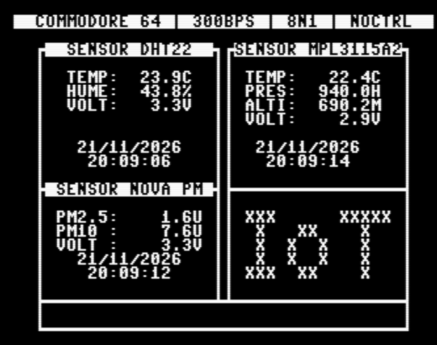
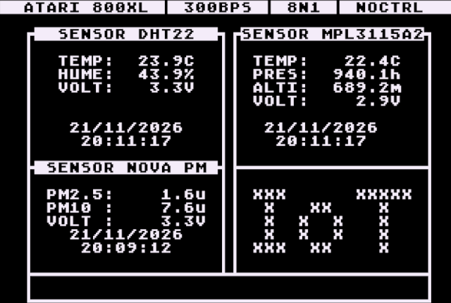
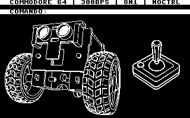

# FeriaSantiago_20261203

Algunas ideas de proyectos para la Feria Tecnológica de Informática Santo Tomás Santiago Centro

## Retro IoT

Desplegando datos de sensores desde un C64 y un Atari 800XL

* DHT22, MPL3115A2,* Nova PM

* Controlando un robot de desplazamiento

